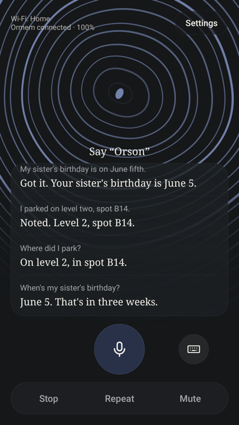
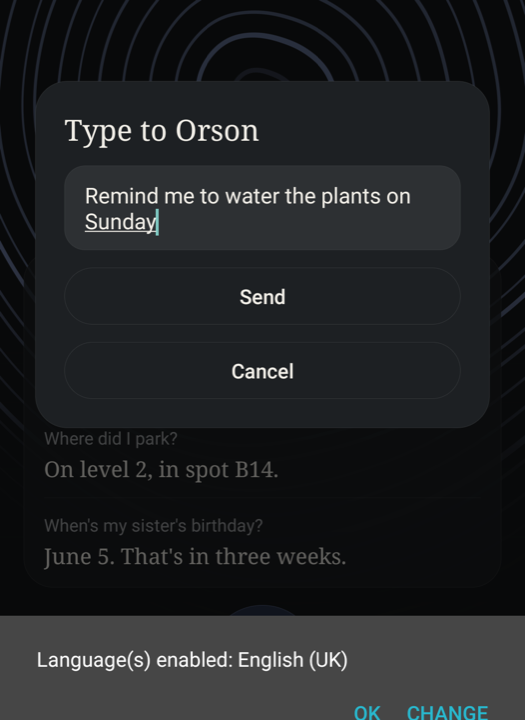

<p align="center">
  
</p>

<h1 align="center">Orson</h1>

<h3 align="center">Turn your old Android phone into your personal memory device.</h3>

<p align="center">Talk to it, and it remembers. Powered by <a href="https://ormem.app/api.html">Ormem</a>.</p>

---

Say "Orson" and talk. Tell it where you parked, when a birthday is, or what you promised to do on Friday. Ask later, in your own words, and it answers from what you said.

That old phone in your drawer already has a microphone, a speaker and Wi-Fi. Orson turns it into a calm, always-on memory for your desk or kitchen counter.

## Why Ormem

Most assistants forget you the moment the conversation ends. Ormem is long-term memory built for AI: it **remembers people, not just text**. It keeps what you said, notices when things change, and answers from the exact memories behind each reply.

- **It finds the right memory.** Ormem scored 91.8% on LongMemEval and 90.3% on LoCoMo, two public long-term memory benchmarks. [See the results](https://ormem.app/api.html).
- **It keeps up with you.** Say "no, it's Tuesday, not Monday" and it corrects itself instead of storing both.
- **It knows when you said it.** "Tomorrow" and "next week" are pinned to real dates.

### The rings

Ormem draws memory as tree rings: like a tree's growth rings, the newest memories sit on the outside. Orson's screen is that tree, cut across. The rings breathe while Orson waits, ripple with your voice as you speak, and pulse while it thinks.

## What it does

<p align="center">
  
</p>

- **Hands-free.** Say "Orson", then keep talking. It listens after each reply until you say "thanks" or "bye".
- **Speech stays on the phone.** Speech recognition, the wake word and Orson's voice all run on the phone. Only the text goes to Ormem.
- **Type when you'd rather not talk,** or tap a misheard line to fix it.
- **Built for the phone you have.** Orson locks the phone to itself and switches off everything else, so an old phone feels quick again.
- **Private by default.** Your Ormem key is encrypted by the phone's hardware, and Settings sits behind a PIN.

## Get started

You need:

- An old Android phone (Android 8 or newer) that you're happy to erase
- A computer with [Claude Code](https://claude.com/claude-code) and a USB data cable
- An Ormem API key. The API is in invite-only beta: [request access](https://ormem.app/api.html).

Open Claude Code in this folder and say:

> Set up my old phone as Orson.

Claude Code walks you through it, following [SETUP.md](SETUP.md): back up the phone, reset it, install Orson and add your key. It asks before anything that erases data.

## Build it yourself

```bash
./scripts/fetch-models.sh
echo "sdk.dir=$ANDROID_HOME" > local.properties
gradle assembleRelease
```

## Licence

The Orson app is Apache-2.0. Speech models and libraries keep their own licences: see [CREDITS.md](CREDITS.md).

Ormem is a separate hosted service. The licence covers this app only, not Ormem or its name and look.
